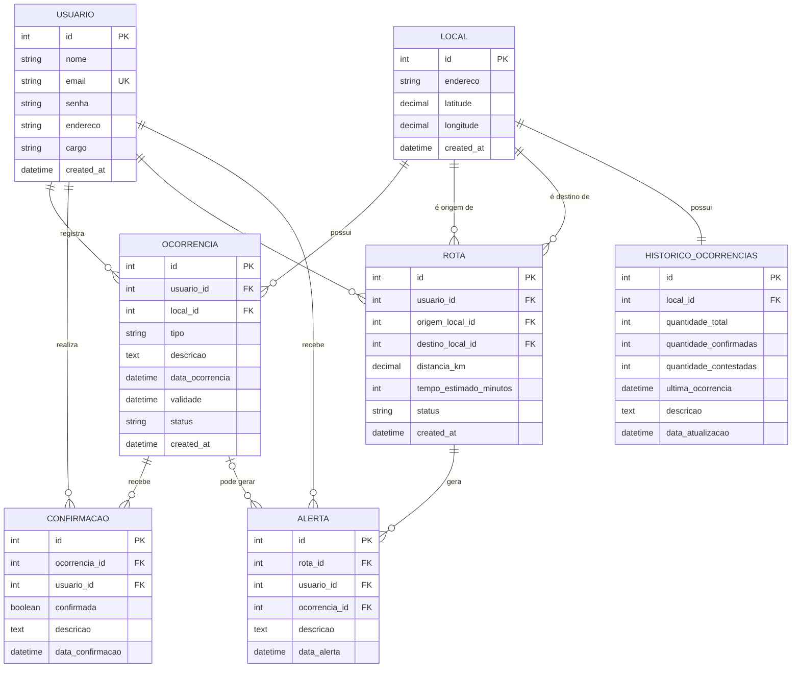

# SafeRoute — Navegação Inteligente e Colaborativa

> Aplicativo de navegação que busca melhorar a mobilidade urbana por meio da identificação colaborativa de alagamentos, enchentes, obras e interdições, oferecendo rotas alternativas aos motoristas.

## Sumário

1. [Sobre o Projeto](#1-sobre-o-projeto)
2. [Identificação do Problema](#2-identificação-do-problema)
3. [Justificativa](#3-justificativa)
4. [Objetivos](#4-objetivos)
5. [Público-Alvo](#5-público-alvo)
6. [Pesquisa Regional](#6-pesquisa-regional)
7. [Pesquisa de Concorrentes](#7-pesquisa-de-concorrentes)
8. [Funcionamento da Aplicação](#8-funcionamento-da-aplicação)
9. [Funcionalidades do Sistema](#9-funcionalidades-do-sistema)
10. [Modelagem do Banco de Dados](#10-modelagem-do-banco-de-dados)
11. [Regras de Negócio](#11-regras-de-negócio)
12. [Tecnologias Propostas](#12-tecnologias-propostas)
13. [Wireframes e Prototipagem](#13-wireframes-e-prototipagem)
14. [Escopo do Projeto](#14-escopo-do-projeto)
15. [Riscos e Desafios](#15-riscos-e-desafios)
16. [Planejamento — Semana 1](#16-planejamento--semana-1)
17. [Fontes de Pesquisa e Levantamento Regional](#17-fontes-de-pesquisa-e-levantamento-regional)
18. [Considerações Finais](#18-considerações-finais)

---

## 1. Sobre o Projeto

O **SafeRoute** é uma proposta de aplicativo de navegação para Android e iOS, inspirado em plataformas como Waze e Google Maps, mas com foco especial na identificação de problemas nas vias públicas.

A aplicação permitirá que motoristas compartilhem informações sobre alagamentos, enchentes, obras e interdições, ajudando outros usuários a evitar trechos comprometidos durante seus deslocamentos.

Inicialmente, o projeto terá como região de atuação os municípios de:

- Americana – SP;
- Santa Bárbara d'Oeste – SP;
- Nova Odessa – SP;
- Sumaré – SP.

## 2. Identificação do Problema

Motoristas frequentemente enfrentam dificuldades durante seus deslocamentos devido a situações inesperadas, como:

- Ruas e avenidas alagadas;
- Enchentes causadas por chuvas intensas;
- Obras e reformas nas vias públicas;
- Ruas temporariamente interditadas;
- Falta de informações atualizadas sobre as condições das vias.

Muitas vezes, os motoristas descobrem esses problemas somente quando chegam ao local, ocasionando atrasos, congestionamentos e situações de risco.

**Problema identificado:** a dificuldade de encontrar rotas alternativas diante de alagamentos, enchentes e interdições, especialmente em regiões onde essas ocorrências são frequentes.

## 3. Justificativa

O desenvolvimento do SafeRoute justifica-se pela necessidade de melhorar a mobilidade urbana e proporcionar maior segurança aos motoristas.

A proposta utiliza a colaboração entre usuários para compartilhar informações sobre as condições das vias, permitindo que outros motoristas sejam alertados antes de chegar a determinados locais.

Com essas informações, o aplicativo poderá identificar trechos comprometidos e oferecer caminhos alternativos, contribuindo para deslocamentos mais seguros e eficientes.

## 4. Objetivos

### Objetivo Geral

Desenvolver um aplicativo de navegação colaborativa capaz de identificar problemas nas vias e oferecer rotas alternativas para evitar regiões com alagamentos, enchentes e obras.

### Objetivos Específicos

- Facilitar a localização de destinos;
- Identificar vias com problemas de circulação;
- Permitir que motoristas compartilhem ocorrências;
- Disponibilizar informações atualizadas sobre as condições das vias;
- Calcular rotas alternativas;
- Melhorar a experiência e a segurança dos deslocamentos.

## 5. Público-Alvo

O aplicativo será destinado principalmente a:

- Motoristas de automóveis;
- Motociclistas;
- Trabalhadores que utilizam veículos diariamente;
- Pessoas que circulam frequentemente pelas cidades atendidas.

## 6. Pesquisa Regional

O levantamento inicial identificou regiões que apresentam registros ou relatos de problemas relacionados a alagamentos e enchentes.

### Americana

- Avenida Bandeirantes;
- Rua Carioba;
- Rua Bahia;
- Rua Diogo de Faria;
- Região da Avenida Paschoal Ardito.

### Santa Bárbara d'Oeste

- Jardim Conceição;
- Vila Sartori;
- Jardim Vista Alegre;
- Jardim Icaraí;
- Região da ponte Roldão Jorge Ferreira.

### Nova Odessa

- Regiões próximas ao Ribeirão Quilombo;
- Passagens inferiores de córregos;
- Áreas monitoradas pela Defesa Civil.

### Sumaré

- Região da Vila Diva;
- Áreas próximas ao Ribeirão Quilombo.

**Observação:** os locais representam um levantamento preliminar. A confirmação dos pontos, trechos e coordenadas deverá ocorrer durante a pesquisa. O cadastro operacional do aplicativo será alimentado exclusivamente pelos usuários.

## 7. Pesquisa de Concorrentes

Foram considerados aplicativos de navegação já utilizados no mercado.

| Aplicativo | Características |
|---|---|
| Waze | Navegação, trânsito e alertas colaborativos. |
| Google Maps | Mapas, pesquisa de destinos e rotas alternativas. |
| Apple Maps | Navegação e informações de trânsito. |

### Diferencial do SafeRoute

O SafeRoute pretende priorizar ocorrências relacionadas a alagamentos, enchentes e obras, oferecendo um sistema de identificação, confirmação e validade dos relatos, integrado ao cálculo de rotas alternativas.

O objetivo não é reproduzir todas as funcionalidades dos concorrentes, mas oferecer uma experiência direcionada à prevenção de problemas durante os deslocamentos.

## 8. Funcionamento da Aplicação

O funcionamento principal será dividido em quatro etapas:

1. **Identificação:** um motorista encontra uma rua alagada, uma enchente ou uma obra.
2. **Registro:** o usuário informa a ocorrência diretamente pelo aplicativo.
3. **Compartilhamento:** a informação aparece no mapa e pode ser confirmada por outros motoristas.
4. **Redirecionamento:** o sistema considera o trecho comprometido e procura uma rota alternativa.

As ocorrências deverão conter localização, categoria, horário e prazo de validade, evitando que informações antigas continuem interferindo nas rotas.

## 9. Funcionalidades do Sistema

### Requisitos Funcionais

| Código | Descrição |
|---|---|
| RF01 | Permitir cadastro de usuários. |
| RF02 | Permitir login e logout. |
| RF03 | Exibir mapa com localização atual. |
| RF04 | Permitir pesquisa de endereços e destinos. |
| RF05 | Calcular rotas entre origem e destino. |
| RF06 | Exibir rotas alternativas. |
| RF07 | Permitir iniciar e encerrar navegação. |
| RF08 | Identificar pontos de alagamento. |
| RF09 | Identificar regiões com enchentes. |
| RF10 | Identificar obras e interdições. |
| RF11 | Permitir registrar ocorrências. |
| RF12 | Registrar localização e horário das ocorrências. |
| RF13 | Permitir confirmar ocorrências. |
| RF14 | Permitir informar que uma via foi liberada. |
| RF15 | Exibir alertas durante a navegação. |
| RF16 | Recalcular rotas para evitar trechos comprometidos. |
| RF17 | Exibir distância e tempo estimado. |
| RF18 | Expirar ocorrências antigas. |
| RF19 | Consultar histórico de ocorrências. |
| RF20 | Permitir denunciar informações incorretas. |

### Requisitos Não Funcionais

| Código | Descrição |
|---|---|
| RNF01 | Compatibilidade com Android e iOS. |
| RNF02 | Interface simples e intuitiva. |
| RNF03 | Boa precisão de localização. |
| RNF04 | Atualização das informações em tempo adequado. |
| RNF05 | Proteção dos dados pessoais. |
| RNF06 | Suporte a múltiplos usuários simultaneamente. |
| RNF07 | Estabilidade durante a navegação. |
| RNF08 | Boa legibilidade da interface. |
| RNF09 | Tolerância a falhas de conexão. |
| RNF10 | Segurança na utilização do aplicativo. |

## 10. Modelagem do Banco de Dados

A modelagem do banco de dados do SafeRoute foi planejada para organizar as informações dos usuários, locais, ocorrências, confirmações, rotas, alertas e históricos.

O modelo utiliza relacionamentos entre as entidades para permitir o registro e o acompanhamento das ocorrências, além de apoiar a identificação de trechos comprometidos e o envio de alertas durante a navegação.

### 10.1 Diagrama Entidade-Relacionamento (DER)

O diagrama abaixo representa a estrutura inicial do banco de dados e os relacionamentos entre suas entidades.

### 10.2 Descrição das Entidades

| Entidade | Descrição |
|---|---|
| USUARIO | Armazena os dados dos usuários cadastrados no aplicativo. |
| LOCAL | Armazena endereços e coordenadas geográficas dos locais registrados. |
| OCORRENCIA | Registra problemas encontrados nas vias, como alagamentos, enchentes, obras e interdições. |
| CONFIRMACAO | Armazena as confirmações ou contestações realizadas pelos usuários sobre uma ocorrência. |
| ROTA | Registra as rotas criadas pelos usuários, incluindo origem, destino, distância e tempo estimado. |
| ALERTA | Armazena os alertas relacionados às rotas e às ocorrências identificadas. |
| HISTORICO_OCORRENCIAS | Mantém informações quantitativas sobre as ocorrências registradas em determinado local. |

### 10.3 Relacionamentos

Os principais relacionamentos definidos na modelagem são:

- Um usuário pode registrar várias ocorrências.
- Um local pode possuir várias ocorrências.
- Uma ocorrência pode receber várias confirmações.
- Um usuário pode realizar várias confirmações.
- Um usuário pode criar várias rotas.
- Uma rota possui um local de origem e um local de destino.
- Uma rota pode gerar vários alertas.
- Um usuário pode receber vários alertas.
- Uma ocorrência pode estar associada a vários alertas.
- Um local possui um registro de histórico de ocorrências.

**Observação:** o diagrama representa a modelagem inicial proposta para o projeto. A implementação física das tabelas, chaves estrangeiras, restrições e regras de integridade deverá ser realizada durante o desenvolvimento do banco de dados.

## 11. Regras de Negócio

- RN01: somente usuários autenticados poderão publicar ocorrências.
- RN02: toda ocorrência deverá possuir categoria e localização.
- RN03: toda ocorrência deverá registrar data e horário.
- RN04: os usuários poderão confirmar ou contestar relatos.
- RN05: ocorrências antigas deverão perder validade automaticamente.
- RN06: ocorrências confirmadas terão maior confiabilidade.
- RN07: trechos bloqueados deverão ser evitados no cálculo de rotas.
- RN08: caso não exista uma rota alternativa segura identificada, o aplicativo deverá informar essa condição.
- RN09: o sistema deverá priorizar a segurança do motorista durante a navegação.
- RN10: a localização deverá ser utilizada conforme as permissões concedidas pelo usuário.

## 12. Tecnologias Propostas

As tecnologias abaixo são sugestões iniciais e poderão ser ajustadas durante o desenvolvimento.

| Tecnologia | Finalidade |
|---|---|
| Flutter | Desenvolvimento multiplataforma. |
| Dart | Linguagem de programação. |
| Supabase | Backend e autenticação. |
| PostgreSQL | Banco de dados. |
| Mapbox ou Google Maps | Exibição de mapas. |
| GPS | Identificação da localização. |

## 13. Wireframes e Prototipagem

A primeira versão do protótipo deverá apresentar as seguintes telas:

### 13.1 Tela de Login e Cadastro

- Campo de e-mail;
- Campo de senha;
- Botão de login;
- Opção de criar conta.

### 13.2 Tela Inicial

- Mapa interativo;
- Localização atual;
- Campo de pesquisa de destino;
- Identificação de ocorrências;
- Acesso ao perfil.

### 13.3 Tela de Rotas

- Origem e destino;
- Rota principal;
- Rotas alternativas;
- Distância e tempo estimado;
- Botão para iniciar navegação.

### 13.4 Tela de Ocorrências

- Alagamentos;
- Enchentes;
- Obras;
- Interdições;
- Confirmação de ocorrências.

### 13.5 Tela de Registro de Ocorrências

- Seleção do tipo de problema;
- Localização da ocorrência;
- Campo para descrição;
- Opção de enviar o registro.

### 13.6 Protótipos de Wireframe

[Visualizar protótipo no Stitch](https://stitch.google.com/projects/969862646073581713)

**Ferramenta sugerida para prototipagem:** Stitch.

## 14. Escopo do Projeto

### Primeira Versão (MVP)

- Cadastro e login;
- Mapa e localização;
- Pesquisa de destinos;
- Cálculo de rotas;
- Registro de ocorrências;
- Confirmação de ocorrências;
- Identificação de vias comprometidas;
- Cálculo de rotas alternativas.

### Funcionalidades Futuras

- Integração com Android Auto;
- Integração com Apple CarPlay;
- Comandos por voz;
- Histórico avançado de ocorrências;
- Análise de padrões de alagamentos;
- Expansão para outras regiões.

## 15. Riscos e Desafios

| Desafio | Possível solução |
|---|---|
| Relatos falsos | Sistema de confirmação e reputação. |
| Poucos usuários | Iniciar em uma região limitada. |
| Ocorrências antigas | Validade automática dos relatos. |
| Falta de internet | Armazenamento temporário quando possível. |
| Rotas incorretas | Integração com serviço de roteamento. |
| Segurança ao dirigir | Alertas por áudio e interface simplificada. |

## 16. Planejamento — Semana 1

**Objetivo:** identificar um problema e definir os requisitos iniciais do projeto.

| Dia | Atividade | Resultado |
|---|---|---|
| Dia 1 | Formação dos grupos e divisão das responsabilidades. | Organização do grupo. |
| Dia 2 | Pesquisa e identificação do problema. | Problema documentado. |
| Dia 3 | Planejamento e definição de requisitos. | Requisitos iniciais. |
| Dia 4 | Desenvolvimento dos wireframes. | Protótipo inicial. |
| Dia 5 | Organização e revisão da documentação. | Entrega final. |

## 17. Fontes de Pesquisa e Levantamento Regional

Para fundamentar o desenvolvimento do **SafeRoute**, foram consultadas fontes oficiais das prefeituras de Americana, Santa Bárbara d’Oeste, Nova Odessa e Sumaré, além de informações disponibilizadas pelo **Centro Nacional de Monitoramento e Alertas de Desastres Naturais (CEMADEN)**.

As fontes reúnem documentos técnicos, notícias e registros relacionados a alagamentos, enchentes, drenagem urbana, interdições de vias públicas e ações realizadas pelas Defesas Civis municipais. Esse levantamento contribui para contextualizar o problema de mobilidade urbana abordado pelo projeto.

> **Nota:** os links abaixo são referências documentais e históricas. A existência de um registro não significa que o local esteja alagado ou interditado atualmente. As condições em tempo real deverão ser verificadas por meio de informações atualizadas e ocorrências confirmadas no aplicativo.

### 17.1 Americana (SP)

- **Plano Municipal de Drenagem de Americana** — documento técnico relacionado às áreas com riscos de inundação e aos problemas de drenagem urbana.  
  [Acessar o documento](https://www.americana.sp.gov.br/legislacao/anexos/lei6049_PlanodeDrenagem.pdf)

- **Monitoramento de áreas atingidas por alagamentos do Ribeirão Quilombo** — notícia sobre os impactos das chuvas e os serviços realizados na Rua Bahia, Avenida Bandeirantes e outras regiões.  
  [Acessar a notícia](https://www.americana.sp.gov.br/americana-index.php?a=noticia&id=37074)

- **Limpeza de áreas afetadas por alagamento** — publicação sobre intervenções na Rua Bahia e na Avenida Bandeirantes, incluindo interdição parcial da avenida.  
  [Acessar a notícia](https://www.americana.sp.gov.br/americana-index.php?a=noticia&id=37076)

- **Impactos das fortes chuvas** — registro de 179 milímetros de chuva em 72 horas e impactos nas proximidades do Ribeirão Quilombo.  
  [Acessar a notícia](https://www.americana.sp.gov.br/americana-index.php?a=noticia&id=37063)

### 17.2 Santa Bárbara d’Oeste (SP)

- **Situação de emergência após chuvas intensas** — notícia sobre alagamentos e danos à ponte Roldão Jorge Ferreira, entre os bairros San Marino e Jardim das Laranjeiras.  
  [Acessar a notícia](https://www.santabarbara.sp.gov.br/portal/noticias/0/3/73913/prefeitura-de-santa-barbara-doeste-decreta-situacao-de-emergencia-apos-chuvas-intensas/)

- **Decreto Municipal nº 7.808/2026** — documento oficial que declara situação de emergência nas áreas afetadas pelas chuvas intensas no município.  
  [Acessar o decreto](https://www.santabarbara.sp.gov.br/portal/leis_decretos/20161)

### 17.3 Nova Odessa (SP)

- **Defesa Civil recebe doação de água sanitária** — publicação municipal relacionada à atuação da Defesa Civil.  
  [Acessar a notícia](https://novaodessa.sp.gov.br/defesa-civil-de-nova-odessa-recebe-doacao-de-600-litros-de-agua-sanitaria-de-empresa-sumareense)

- **Obras na travessia do Córrego Capuava** — notícia sobre problemas históricos de alagamentos e erosão na Avenida Ampélio Gazzetta, na região conhecida como Pescoço da Égua.  
  [Acessar a notícia](https://novaodessa.sp.gov.br/noticias/destaques/comecam-as-obras-para-a-nova-travessia-do-corrego-capauva-em-nova-odessa)

- **Interdição da Avenida Ampélio Gazzetta** — publicação sobre o bloqueio da avenida para obras e as rotas alternativas para motoristas.  
  [Acessar a notícia](https://novaodessa.sp.gov.br/interdicao-total-da-avenida-ampelio-gazzetta-no-trecho-do-pescoco-da-egua-comeca-quarta-feira-2705)

- **Limpeza de ruas atingidas pelas chuvas** — notícia sobre os trabalhos no Jardim São Jorge e em regiões afetadas pelas chuvas, além do monitoramento do Ribeirão Quilombo.  
  [Acessar a notícia](https://novaodessa.sp.gov.br/noticias/destaques/forca-tarefa-em-nova-odessa-trabalha-na-limpeza-das-ruas-atingidas-pelas-chuvas-1)

### 17.4 Sumaré (SP)

- **Regiões atingidas por alagamentos** — publicação sobre ações de prevenção à leptospirose após enchentes nos bairros Vila Diva, Três Pontes, Jardim Primavera e São Domingos, além da Rua Crenac.  
  [Acessar a notícia](https://www.sumare.sp.gov.br/cidadao/noticia/sumare-reforca-prevencao-a-leptospirose-nas-regioes-atingidas-por-alagamentos)

- **Plano Diretor de Sumaré** — documento de planejamento urbano que pode apoiar análises territoriais e ambientais do município.  
  [Acessar o documento](https://www.sumare.sp.gov.br/plano_diretor/arquivos/mapVol1/VOLUME01COMPLETO.pdf)

### 17.5 Fontes Federais — CEMADEN

- **Municípios monitorados** — informações sobre municípios monitorados em razão do histórico de desastres naturais, incluindo inundações, enxurradas e grandes alagamentos.  
  [Acessar a página](https://www.gov.br/cemaden/pt-br/paginas/municipios-monitorados)

- **Painel de Alertas em Tempo Real** — plataforma para consulta de alertas de riscos geo-hidrológicos.  
  [Acessar o painel](https://painelalertas.cemaden.gov.br/)

- **Previsão de Riscos Geo-Hidrológicos** — informações e boletins sobre riscos de inundações e outros eventos relacionados às chuvas.  
  [Acessar a página](https://www.gov.br/cemaden/pt-br/assuntos/riscos-geo-hidrologicos/)

- **Mapas Interativos** — ferramenta de visualização de informações relacionadas ao monitoramento e à prevenção de desastres.  
  [Acessar os mapas](https://educacao.cemaden.gov.br/mapas-interativos-do-cemaden-ciencia-aplicada-na-prevencao-de-desastres/)

### 17.6 Referências Complementares

- **Waze** — recursos de navegação, trânsito e alertas colaborativos.
- **Google Maps** — recursos de mapas, pesquisa de destinos e rotas alternativas.
- **Apple Maps** — recursos de navegação e informações de trânsito.

### 17.7 Considerações sobre o Levantamento

As informações consultadas ajudam a demonstrar a existência de problemas relacionados a alagamentos, enchentes, drenagem urbana e interdições nas cidades abrangidas pelo SafeRoute.

Os registros apresentados são utilizados como **referências documentais e históricas**. Eles não indicam, necessariamente, que os locais estejam alagados ou interditados no momento da consulta. A identificação de ocorrências em tempo real será realizada por meio das informações enviadas e confirmadas pelos usuários do aplicativo.

## 18. Considerações Finais

O SafeRoute busca desenvolver uma solução tecnológica voltada a um problema real de mobilidade urbana.

Por meio da colaboração entre motoristas, o aplicativo pretende oferecer informações sobre as condições das vias e facilitar a identificação de caminhos alternativos.

Nesta primeira etapa, foram definidos o problema, a proposta de solução, o público-alvo, os requisitos iniciais, a modelagem do banco de dados, as tecnologias propostas e a estrutura das telas.

As próximas etapas do projeto serão destinadas ao aprofundamento dos requisitos, desenvolvimento do protótipo e implementação das funcionalidades.

**SafeRoute — Seu caminho mais seguro começa com a informação.**
